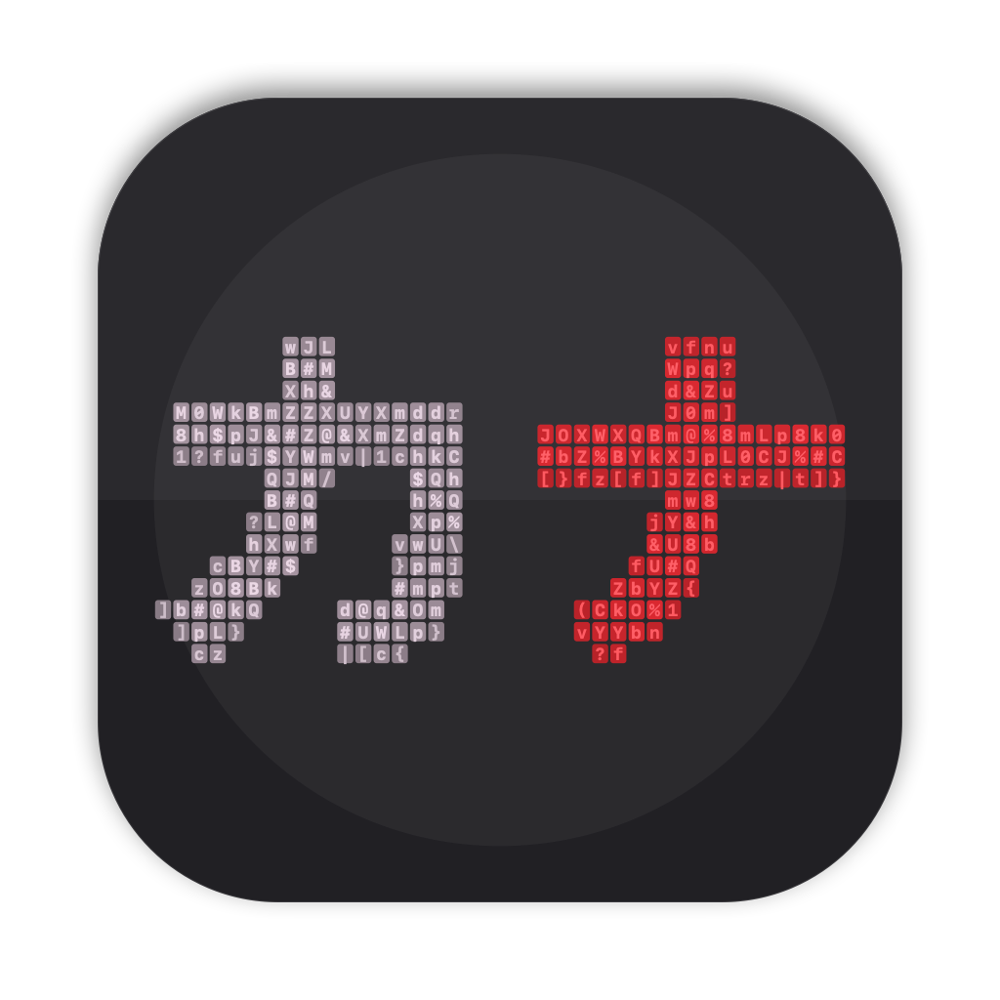
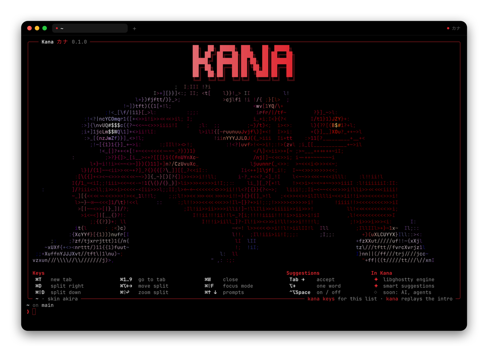
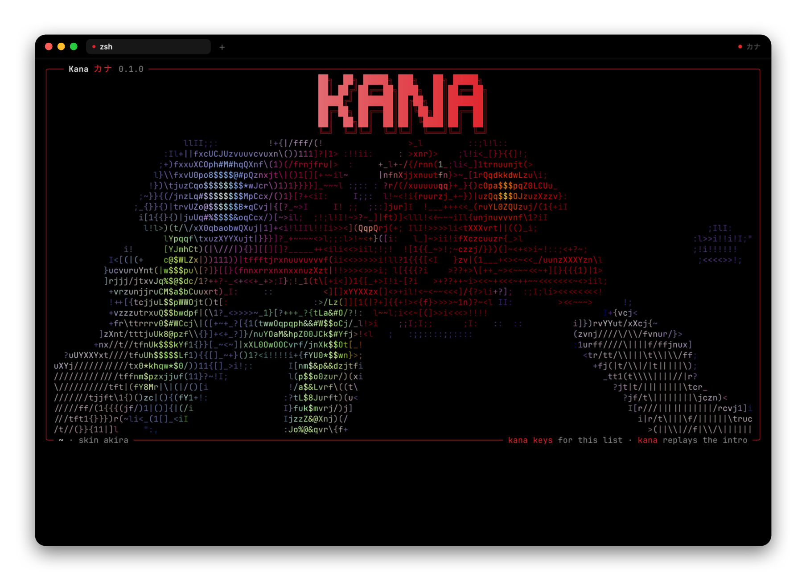

<p align="center">
  
</p>

<h1 align="center">Kana カナ</h1>

<p align="center">
  A native macOS terminal built on <a href="https://ghostty.org">Ghostty</a>'s engine.<br>
  Pure black, one red accent, an ASCII anime intro, and suggestions you accept with Tab.
</p>

<p align="center">
  
  
  
  
</p>

<p align="center">
  
</p>

---

Kana is a terminal I'm building for my own daily use. Under the hood it's **libghostty**, the same engine Ghostty runs on: GPU rendering, fonts, ligatures, true colour and a correct VT emulator. On top of that it has a Mew-style layout and a few things I wanted every day.

The name is a nod to Kaneda, and *kana* are also the Japanese syllable characters. A terminal is a grid of characters, and the mascot is an anime scene drawn in characters, so it fits twice.

## The welcome screen

Every new tab opens with a box like Claude Code's. The KANA wordmark sits on top, then the Akira bike slide plays in ASCII at the full width of the box. The camera pushes in on Kaneda as he comes to rest, then the bottom line slides down and the keys pop up underneath.

<p align="center">
  
</p>

- It's real terminal output, so it stays in your scrollback
- It's sized to fit your window, so KANA, the art, the keys and your prompt all fit on one screen
- Any key skips the animation. Type `kana` to replay it, or `kana keys` for just the list
- The art comes from the video at 13 different widths, and `kana` loads the one closest to your window, so it's sharp at any size

## Features

**Terminal**
- libghostty engine, pinned to an exact revision through [libghostty-spm](https://github.com/Lakr233/libghostty-spm)
- Pure black by default, plus **657 themes** (`theme = ...`, or follow the system with `light:X,dark:Y`)
- Every Ghostty option works: fonts, keybinds, palette, scrollback. Kana's config passes them straight through
- ⌘-click links (with Ghostty's safe-URL rules), and ⌘-hover shows where a link goes

**Tabs and splits**
- Tabs live in a slim header next to the traffic lights, and show the current folder or command
- Split any way you like, move between splits with the keyboard, zoom one, or make them all equal
- Focus Mode hides the header

**Suggestions and completion** (zsh)
- As you type, the rest of a likely command shows in grey. **Tab** takes it, and so do **→** or **End**. **⌥→** takes one word
- Command names come from your history first, then your installed commands, so `gi` offers `git`
- Paths complete in any case: `cd doc` + Tab becomes `cd Documents/`
- With no suggestion showing, Tab gives you zsh's full completion, with case-insensitive matching and a menu you can arrow through

**Getting things done**
- Command palette (⌘⇧K) for every menu action and every theme, with fuzzy search
- Sessions: every run is saved, ⌘⇧O brings back an earlier one, and ⌘⇧T reopens a closed tab
- A notification when a long command finishes while you're in another app; clicking it takes you to the pane
- Attention dots on tabs, a Dock badge, and progress bars from programs that report them

## Install

Kana isn't packaged yet, so you build it yourself. It needs **macOS 14+ on Apple silicon** and either **Xcode** or the **Command Line Tools**.

```bash
git clone https://github.com/jakalwaz/kana.git
cd kana
script/run      # builds build/Kana.app and opens it
```

```bash
script/test     # Swift tests, zsh suggestion tests, converter tests, app build
```

Running the tests needs full Xcode. Building only needs the Command Line Tools.

To use `kana` (the welcome screen) in other terminals too:

```bash
ln -sf "$PWD/build/Kana.app/Contents/Resources/bin/kana" ~/.local/bin/kana
```

## Keys

| | |
|---|---|
| **⌘T** / **⌘N** | New tab / new window |
| **⌘W** / **⌘⌥W** / **⌘⇧W** | Close split / close tab / close window |
| **⌘⇧T** | Reopen closed tab |
| **⌘⇧O** | Session history |
| **⌘1…9**, **⌘⇧[** **⌘⇧]** | Go to a tab / previous or next tab |
| **⌘D** / **⌘⇧D** | Split right / split down |
| **⌘[** **⌘]**, **⌘⌥←↑↓→** | Move between splits |
| **⌘⇧↩** / **⌘⌃=** | Zoom split / equalize splits |
| **⌘⇧K** | Command palette |
| **⌘⇧F** / **⌘⌃F** | Focus Mode / full screen |
| **⌘K** | Clear the screen |
| **⌘↑** **⌘↓** | Jump between prompts |
| **⌘+** **⌘−** **⌘0** | Text size |
| **Tab**, **→** / **⌥→** | Accept the suggestion / accept one word |
| **⌃⌥Space** | Suggestions on or off |
| **⌘,** / **⌘⇧,** | Open the config folder / reload the config |

## Configure

Everything lives in `~/.config/kana/config`, in Ghostty's `key = value` format. A few keys are Kana's own; anything else goes straight to Ghostty.

```ini
skin = default            # or streak, or any folder in ~/.config/kana/skins/
intro = on                # on (every tab), first-window, off
banner = on               # the welcome screen
suggestions = on
# theme = Kanagawa Wave  # leave it out for Kana's pure black, or light:X,dark:Y
notify-on-command-finish = unfocused   # never, unfocused, always
notify-on-command-finish-after = 10s

# any Ghostty option
font-family = JetBrains Mono
font-size = 14
```

## Skins

A skin is a folder with a `skin.json` and its intro frames. Kana ships two:

- **default**: the Akira bike slide, with the camera pushing in on Kaneda
- **streak**: an original red light streak, drawn in code by `tools/ascii/make_default_skin.py`

You can make your own from any clip or image with `tools/ascii/convert.py`. It handles cropping, a moving crop that pushes in on a subject, colour keying, edge boost and character ramps, and plays the result right in your terminal. `convert.py snapshot` renders any frame as an SVG window through [termframe](https://github.com/pamburus/termframe). The whole workflow is in [`tools/ascii/README.md`](tools/ascii/README.md).

```bash
python3 tools/ascii/convert.py convert my-clip.mp4 --width 120 --fps 30 \
  --luma value --vivid -o ~/.config/kana/skins/mine/intro.kana --preview
```

## How it's built

```
App/          AppKit app: windows, tabs, splits, palette, notifications
App/Shell/    zsh layer: suggestions, completion, prompt, welcome screen hook
Core/         config, split tree, sessions, fuzzy matching (plain Swift, tested)
CLI/          the `kana` command and the welcome screen layout
Packages/     KanaSkins: loads .kana frame files
tools/ascii/  video → ASCII converter, with tests
```

All of the libghostty code sits in `App/Terminal/TerminalBridge.swift`, and where Ghostty's own Mac app already solved something, Kana follows how it does it.

Kana is built by two AI agents working together: Claude Code leads and Codex reviews and takes tasks. [`AGENTS.md`](AGENTS.md), [`CLAUDE.md`](CLAUDE.md) and [`TASKS.md`](TASKS.md) describe how they split the work. The full spec is in [`docs/KANA.md`](docs/KANA.md).

## Roadmap

- [x] libghostty terminal, tabs, splits, themes, config
- [x] Suggestions, completion, command palette, sessions, notifications
- [x] Welcome screen and skins
- [ ] Settings window
- [ ] Quick terminal on a global hotkey
- [ ] **AI, with your own keys** (Anthropic, OpenAI, Gemini, OpenRouter): ⌘I turns plain English into a command for you to run, an Explain button on failed commands, and a sidebar chat that sees your terminal
- [ ] **Agent panes**: Claude Code, Codex and others side by side, each in its own git worktree, with a badge when one needs you

## Credits

- [Ghostty](https://github.com/ghostty-org/ghostty) by Mitchell Hashimoto and contributors (MIT): the engine, and the reference for how a Mac terminal should behave
- [libghostty-spm](https://github.com/Lakr233/libghostty-spm) (MIT): the prebuilt libghostty Swift package
- [iTerm2-Color-Schemes](https://github.com/mbadolato/iTerm2-Color-Schemes) (MIT): the themes
- [termframe](https://github.com/pamburus/termframe): terminal screenshots for skin previews
- [Mew](https://github.com/importkaizen/homebrew-mew): the layout inspiration
- *Akira* © Katsuhiro Otomo / Kodansha / TMS Entertainment. The default skin is a non-commercial fan tribute; the frames are ASCII drawn from a two-second clip, and no video is included

## License

Not chosen yet. Kana's own code will get a licence soon. Ghostty and the libraries above keep their own licences.
